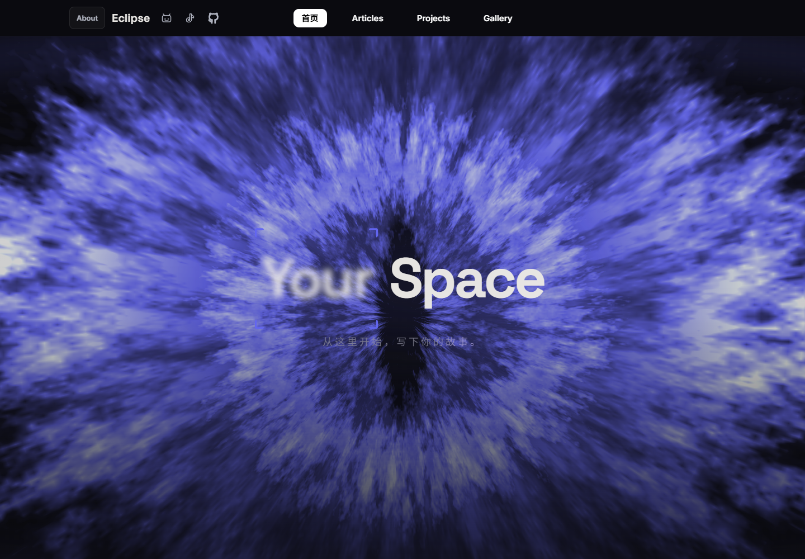

# Eclipse

一个深色个人博客模板，基于 Vue 3、Vite 和 Django。首页保留眼睛开合与导航过渡，三个分区分别展示文章、作品和影像，内容通过 Django 后台编辑。



[Articles](docs/screenshots/ctf.png) · [Projects](docs/screenshots/editing.png) · [Gallery](docs/screenshots/games.png) · [About](docs/screenshots/about.png)

> 维护者原创部分采用 [Unlicense](LICENSE)：可以自由使用、修改、分发和商用，不要求署名，也不要求修改版继续开源。第三方组件不在此版权放弃范围内，详见 [许可范围](LICENSE_SCOPE.md)。当前仍为本地发布准备版，动效组件的来源与分发条件见 [第三方说明](THIRD_PARTY_NOTICES.md)。

## 界面与功能

- 首页：WebGL 眼睛、聚焦文字、发光卡片、流体导航。
- Articles：文章分类、分页、Markdown、代码高亮、文章目录和阅读进度。
- Projects / Gallery：作品卡片、视频链接和动态背景。
- About：介绍、卡片和联系方式可在后台编辑。
- 管理后台：文章草稿/发布、分类、标签、图片上传及 Markdown 编辑器。

模板包含虚构文章、程序生成的几何配图和演示动画；About 与 Gallery 使用维护者选定的两段原站背景视频。不包含站长的数据库、账号、私人文章或原始文章截图。

## 本地运行

需要 Python 3.12+、Node.js 22.12+。以下命令在项目根目录执行。

### Windows PowerShell

```powershell
python -m venv .venv
.\.venv\Scripts\python.exe -m pip install -r backend/requirements.txt
Copy-Item backend/.env.example backend/.env
.\.venv\Scripts\python.exe backend/manage.py migrate
.\.venv\Scripts\python.exe backend/manage.py seed_demo
.\.venv\Scripts\python.exe backend/manage.py createsuperuser
.\.venv\Scripts\python.exe backend/manage.py runserver 127.0.0.1:8000
```

另开终端：

```powershell
cd frontend
npm ci
Copy-Item .env.example .env
npm run dev
```

### macOS / Linux

```bash
python3 -m venv .venv
.venv/bin/python -m pip install -r backend/requirements.txt
cp backend/.env.example backend/.env
.venv/bin/python backend/manage.py migrate
.venv/bin/python backend/manage.py seed_demo
.venv/bin/python backend/manage.py createsuperuser
.venv/bin/python backend/manage.py runserver 127.0.0.1:8000
```

另开终端，在 `frontend` 下执行 `npm ci`、`cp .env.example .env`、`npm run dev`。

- 前台：<http://127.0.0.1:5173>
- 后台：<http://127.0.0.1:8000/admin/>
- 没有预设管理员或默认密码，请用 `createsuperuser` 创建自己的账号。
- `seed_demo` 可重复执行，不覆盖已存在的文章；示例可在后台删除。
- 开发环境未设置密钥时会使用临时随机密钥，重启后旧会话失效。需要保留登录状态时，在本地 `.env` 中设置自己的密钥。

## 从哪里改成自己的博客

| 要改的内容 | 位置 |
|---|---|
| 站点名、首页标题、标语、备案号、导航社交链接 | `frontend/.env`，参照 `.env.example` |
| 站点分享标题和描述 | `frontend/index.html` |
| 文章、分类、标签、About、分区文案 | Django 管理后台 |
| 导航栏目名称 | `frontend/src/components/common/NavBar.vue`；首页卡片与页面标题见对应页面及 `router/index.js` |
| 默认示例文章 | `backend/demo/posts.json` |
| 主题颜色、字体和基础样式 | `frontend/src/styles/main.scss` |
| 各页布局、动效参数 | `frontend/src/views/` 和 `frontend/src/components/effects/` |
| About / Gallery 背景 | `frontend/public/wallpaper/aboutme.mp4` / `elden-ring-wallpaper.mp4`；可通过 `VITE_ABOUT_VIDEO` / `VITE_GAMES_VIDEO` 替换 |
| 示例作品视频 | `frontend/public/demo/ambient.mp4` |
| 服务端密钥、域名 | `backend/.env` |

`VITE_*` 配置会进入浏览器，不能放密码或服务端密钥。更改前端环境变量后要重启开发服务或重新构建。

关于字体：默认从 Google Fonts 加载，页面也配置了本地字体回退。需要完全离线时可删除 `index.html` 中的远程字体链接，或自行托管字体。

## 检查和构建

```bash
python backend/manage.py check
python backend/manage.py test blog accounts
cd frontend
npm run check:nav
npm run build
```

使用前面创建的虚拟环境执行 Python 命令。生产部署见 [DEPLOY.md](DEPLOY.md)，发布前的文件整理见 [PUBLISHING.md](PUBLISHING.md)。

## 目录

```text
backend/            Django API、后台、数据库迁移和示例内容
frontend/           Vue 页面、样式、动效与示例素材
tools/              示例素材生成、发布检查与打包工具
licenses/           第三方许可证原文
```

SQLite 数据库、上传目录、真实 `.env`、依赖目录和构建输出都不属于模板源码，已加入 `.gitignore`。

默认栏目为 Articles（文章）、Projects（作品）、Gallery（影像）。About 中的姓名、身份、介绍与联系地址都是示例占位，使用前请替换。内部板块标识及路径暂沿用 `ctf`、`editing`、`games`，它们不限定实际内容主题。新安装时的页面初始内容位于 `backend/blog/migrations/`，API 备用文案位于 `backend/blog/models.py`，前端备用文案位于各页面。已有站点请直接在后台修改栏目文案。
