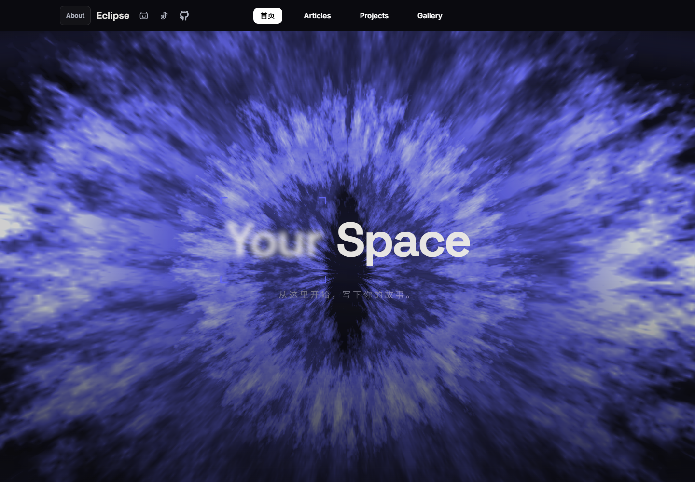

# Eclipse/日蚀

**强烈推荐 先看示例！！！ [首页 · 52HzEc1p](https://52hzec1p.cn/)**
历时一周的vibe-coding的赛博博客模板作品，基于 Vue 3、Vite 和 Django，使用codex+kimi+astra制作。首页是精心设计的魔眼眨眼的动画入场，共有三个内容分区，可自行进行内容安排，内容通过 Django 后台编辑。适合喜欢酷炫风格的人使用。

**[下载服务器部署包](https://github.com/52HzEc1p/Eclipse-Blog/releases/download/v0.1.0/Eclipse-Blog-a868489-deploy.zip)** · [查看版本说明](https://github.com/52HzEc1p/Eclipse-Blog/releases/tag/v0.1.0) · [源码部署说明](DEPLOY.md)



[Articles](docs/screenshots/ctf.png) · [Projects](docs/screenshots/editing.png) · [Gallery](docs/screenshots/games.png) · [About](docs/screenshots/about.png)

> 维护者原创部分采用 [Unlicense](LICENSE)：可以自由使用、修改、分发和商用，不要求署名，也不要求修改版继续开源。第三方组件不在此版权放弃范围内，详见 [许可范围](LICENSE_SCOPE.md)。动效组件的来源与分发条件仍需核对，见 [第三方说明](THIRD_PARTY_NOTICES.md)。

## 界面与功能

- 首页：WebGL 魔焰眼睛、聚焦文字、发光卡片、流体导航。
- Articles：文章分类、分页、Markdown、代码高亮、文章目录和阅读进度。
- Projects / Gallery：作品卡片、视频链接和动态背景。
- About：介绍、卡片和联系方式可在后台编辑。
- 管理后台：文章草稿/发布、分类、标签、图片上传及 Vditor Markdown 编辑器，支持即时渲染、源码切换、全屏和本机草稿恢复。

模板包含虚构文章、程序生成的几何配图和演示动画；About 与 Gallery 使用维护者选定的两段原站背景视频。不包含站长的数据库、账号、私人文章或原始文章截图。

## 下载与服务器部署

如果想部署到服务器，再通过后台管理文章和页面内容，可以直接使用部署包。

| 下载方式 | 适合用途 | 包含内容 |
|---|---|---|
| [服务器部署包（v0.1.0）](https://github.com/52HzEc1p/Eclipse-Blog/releases/download/v0.1.0/Eclipse-Blog-a868489-deploy.zip) | 部署博客，日常在后台更新内容 | Django 后端、已构建的 `frontend/dist`、示例素材和部署说明 |
| 克隆仓库或下载 Source code | 修改前端配置、页面布局和动效，继续开发 | 项目源码；需要自行安装前端依赖并构建 |

部署包的前端已经构建好，首次部署可以跳过 Node.js 安装和 `npm run build`。服务器仍需 Python 3.12+、Nginx 和 HTTPS，并安装 `backend/requirements.txt` 中的后端依赖。

基本流程：

1. 下载 `Eclipse-Blog-a868489-deploy.zip`，将包内 `Eclipse-Blog` 目录的内容解压到服务器项目目录。
2. 按包内 `README.md` 安装 Python 依赖，配置 `backend/.env` 中的密钥、域名和 HTTPS 来源。
3. 运行数据库迁移、收集静态文件，再用 `createsuperuser` 创建自己的管理员账号。需要示例文章时可运行 `seed_demo`。
4. 配置并常驻运行 Gunicorn；按 `nginx.conf.example` 配置 Nginx，网站根目录指向 `frontend/dist`，并配置 HTTPS。
5. 访问 `https://你的域名/admin/` 登录后台，修改内容后保存，再刷新前台查看。

**后台可以修改：**文章正文、摘要、封面、视频链接、发布状态、分类、标签、About 介绍和联系方式，以及栏目页标题、描述、筛选项等文案。首页的栏目卡片会读取后台设置的栏目标题和描述，普通内容修改无需重新构建前端。

**需要修改前端配置或源码：**全站名称、首页主标题和标语、备案号、导航名称与社交链接、背景视频配置，以及布局、样式和动效。修改这些内容时，请使用源码版重新构建，再替换服务器上的 `frontend/dist`。后台 About 页的“站点名”只影响该页面。

GitHub 自动附带的 `Source code (zip)` 不包含已构建的前端，直接部署请下载文件名带 `deploy` 的压缩包。源码版的完整部署流程见 [DEPLOY.md](DEPLOY.md)。

更新已有博客前，请先备份并保留服务器上的 `backend/.env`、`backend/db.sqlite3` 和 `backend/media/`。

## 源码版：本地运行

需要 Python 3.12+、Node.js 22.12+。以下命令在项目根目录执行。

### Windows PowerShell

```powershell
python -m venv .venv
.\.venv\Scripts\python.exe -m pip install -r backend/requirements.txt
Copy-Item backend/.env.example backend/.env
.\.venv\Scripts\python.exe backend/manage.py migrate
.\.venv\Scripts\python.exe backend/manage.py seed_demo
.\.venv\Scripts\python.exe backend/manage.py createsuperuser
.\.venv\Scripts\python.exe backend/manage.py runserver 127.0.0.1:8000
```

另开终端：

```powershell
cd frontend
npm ci
Copy-Item .env.example .env
npm run dev
```

### macOS / Linux

```bash
python3 -m venv .venv
.venv/bin/python -m pip install -r backend/requirements.txt
cp backend/.env.example backend/.env
.venv/bin/python backend/manage.py migrate
.venv/bin/python backend/manage.py seed_demo
.venv/bin/python backend/manage.py createsuperuser
.venv/bin/python backend/manage.py runserver 127.0.0.1:8000
```

另开终端，在 `frontend` 下执行 `npm ci`、`cp .env.example .env`、`npm run dev`。

- 前台：<http://127.0.0.1:5173>
- 后台：<http://127.0.0.1:8000/admin/>
- 没有预设管理员或默认密码，请用 `createsuperuser` 创建自己的账号。
- `seed_demo` 可重复执行，不覆盖已存在的文章；示例可在后台删除。
- 开发环境未设置密钥时会使用临时随机密钥，重启后旧会话失效。需要保留登录状态时，在本地 `.env` 中设置自己的密钥。

## 从哪里替换为自己的博客（建议直接使用agent辅助替换）

| 要改的内容                  | 位置                                                                                                                  |
| ---------------------- | ------------------------------------------------------------------------------------------------------------------- |
| 站点名、首页标题、标语、备案号、导航社交链接 | `frontend/.env`，参照 `.env.example`                                                                                   |
| 站点分享标题和描述              | `frontend/index.html`                                                                                               |
| 文章、分类、标签、About、分区文案    | Django 管理后台                                                                                                         |
| 导航栏目名称                 | `frontend/src/components/common/NavBar.vue`；首页卡片与页面标题见对应页面及 `router/index.js`                                       |
| 默认示例文章                 | `backend/demo/posts.json`                                                                                           |
| 主题颜色、字体和基础样式           | `frontend/src/styles/main.scss`                                                                                     |
| 各页布局、动效参数              | `frontend/src/views/` 和 `frontend/src/components/effects/`                                                          |
| About / Gallery 背景     | `frontend/public/wallpaper/aboutme.mp4` / `elden-ring-wallpaper.mp4`；可通过 `VITE_ABOUT_VIDEO` / `VITE_GAMES_VIDEO` 替换 |
| 示例作品视频                 | `frontend/public/demo/ambient.mp4`                                                                                  |
| 服务端密钥、域名               | `backend/.env`                                                                                                      |

`VITE_*` 配置会进入浏览器，不能放密码或服务端密钥。更改前端环境变量后要重启开发服务或重新构建。

关于字体：默认从 Google Fonts 加载，页面也配置了本地字体回退。需要完全离线时可删除 `index.html` 中的远程字体链接，或自行托管字体。

## 检查和构建

```bash
python backend/manage.py check
python backend/manage.py test blog accounts
node --test backend/blog/browser_tests/markdown_preservation.test.cjs
cd frontend
npm run check:nav
npm run build
```

使用前面创建的虚拟环境执行 Python 命令。生产部署见 [DEPLOY.md](DEPLOY.md)，发布前的文件整理见 [PUBLISHING.md](PUBLISHING.md)。

后台编辑器依赖随源码提供，不依赖外部 CDN。未修改正文时保存会保留原始 Markdown；本机草稿按用户与文章区分，保留七天，恢复标题、摘要和正文后仍需手动保存。完整浏览器回归检查见 [编辑器测试说明](backend/blog/browser_tests/README.md)。

## 目录

```text
backend/            Django API、后台、数据库迁移和示例内容
frontend/           Vue 页面、样式、动效与示例素材
tools/              示例素材生成、发布检查与打包工具
licenses/           第三方许可证原文
```

SQLite 数据库、上传目录、真实 `.env`、依赖目录和构建输出都不属于模板源码，已加入 `.gitignore`。

默认栏目为 Articles（文章）、Projects（作品）、Gallery（影像）。About 中的姓名、身份、介绍与联系地址都是示例占位，使用前请替换。内部板块标识及路径暂沿用 `ctf`、`editing`、`games`，它们不限定实际内容主题。新安装时的页面初始内容位于 `backend/blog/migrations/`，API 备用文案位于 `backend/blog/models.py`，前端备用文案位于各页面。已有站点请直接在后台修改栏目文案。
